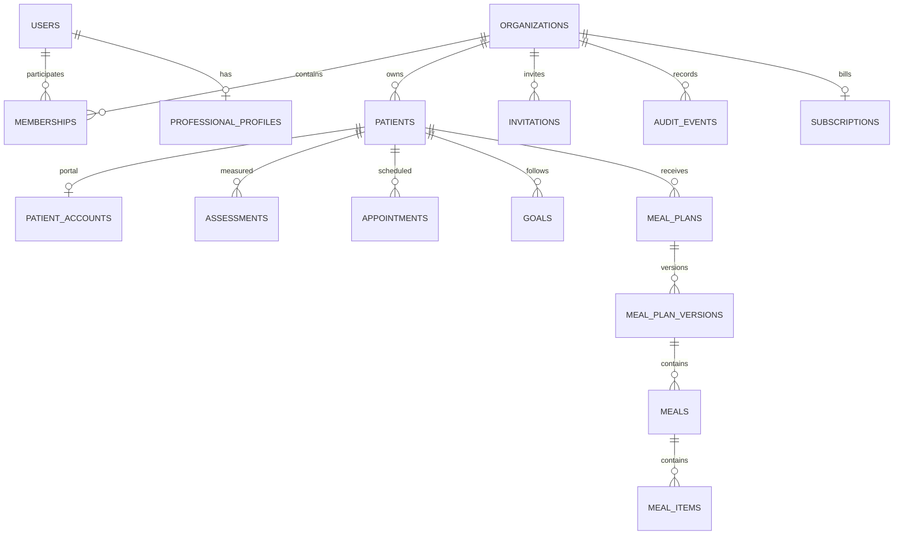

# Proposta de modelo relacional — NutriTrack

**Status:** desenho lógico para revisão; não é schema aprovado nem migration.  
**Banco recomendado:** PostgreSQL.  
**Pré-condição:** aprovar tenant, papéis/equipe, vínculo/transferência de paciente e retenção antes da implementação.

## 1. Princípios

- UUIDs existentes podem ser preservados como `uuid` quando únicos e válidos; PK UUID gerada no banco para novos registros.
- Datas de evento como `timestamptz`; datas clínicas sem horário como `date`. Usar UTC para instantes e manter semântica local para agendamento/timezone se o produto precisar.
- `tenant_id` obrigatório nos dados clínicos. FKs compostas `(tenant_id, related_id)` impedem ligações entre consultórios. Uma tabela global de identidade é exceção explícita.
- `created_at`, `updated_at`, estados e `deleted_at` somente quando a política de ciclo de vida aprovar; exclusão lógica não deve substituir retenção definida.
- Campos de texto clínico nunca entram em logs/eventos de auditoria. Campos flexíveis JSONB só para snapshots/metadata controlados, não como substituto indiscriminado de relações.
- Dados de cartão não são armazenados. Identificadores externos do provedor de pagamento são referências, não credenciais.

## 2. Diagrama lógico

O diagrama assume tenant organização e portal ligado a vínculo explícito. Cardinalidade de usuário/paciente entre organizações depende da decisão de produto.

## 3. Tabelas e campos

### `users`

- **Finalidade:** identidade autenticável global, separada do perfil profissional e do cadastro clínico do paciente.
- **Campos:** `id uuid PK`, `email`, `email_normalized`, `password_hash`, `password_salt`/formato de hash versionado, `status`, `email_verified_at`, `created_at`, `updated_at`.
- **Restrições/índices:** `UNIQUE(email_normalized)` (ou unicidade por tenant somente se decisão explícita); email normalizado no serviço; status permitido. Nunca armazenar senha em claro.
- **FK/tenant:** global, sem `tenant_id`; relaciona por `memberships`/`patient_accounts`.
- **Retenção:** política para conta encerrada e anonimização; impedir exclusão enquanto referências obrigatórias existirem. Separar identidade duplicada exige fluxo de merge auditado.

### `professional_profiles`

- **Finalidade:** nome e atributos profissionais não credenciais.
- **Campos:** `id uuid PK`, `user_id uuid FK UNIQUE`, `display_name`, campos profissionais aprovados pelo produto, timestamps.
- **Restrições/índices:** FK para `users`; índices apenas para busca necessária.
- **Relação tenant:** acesso pelo membership; perfil global pode servir mais de um tenant se permitido.
- **Retenção:** arquivar conforme vínculo e exigências definidas; remoção depende do ciclo de vida de user/membership.

### `organizations`

- **Finalidade:** fronteira de tenant, política de acesso e possível unidade de cobrança.
- **Campos:** `id uuid PK`, `name`, `status`, `created_at`, `updated_at`, `archived_at` opcional.
- **Restrições/índices:** status permitido; índices de estado/nome somente se necessários.
- **Relação tenant:** é o tenant. Consultas clínicas sempre escopadas a `organization_id`.
- **Retenção:** suspensão não apaga prontuários; encerramento, exportação e retenção são decisões humanas.

### `memberships`

- **Finalidade:** associar usuário à organização e conceder papel.
- **Campos:** `id uuid PK`, `organization_id`, `user_id`, `role`, `status`, `created_at`, `ended_at`, `invited_by_user_id` opcional.
- **Chaves:** FK org e user; `UNIQUE(organization_id,id)` para FKs tenant-aware; possivelmente unique de membership ativa por org/user.
- **Índices:** `(organization_id,user_id,status)`, `(user_id,status)`.
- **Retenção:** manter histórico de início/fim para auditoria; revogar acesso imediatamente ao terminar vínculo; política de histórico é definida pelo produto.

### `patients`

- **Finalidade:** cadastro clínico no tenant, substitui `patients` atual sem supor identidade global compartilhada.
- **Campos:** `id uuid PK`, `organization_id`, `created_by_user_id`, `name`, `email`, `phone`, `birth_date`, `sex` somente se já usado e aprovado, `clinical_notes`, `status`, timestamps, `archived_at` opcional.
- **Chaves:** `UNIQUE(organization_id,id)`; FK composta `(organization_id, created_by_user_id)` idealmente referenciando membership (ou FK para membership responsável); não usar e-mail como identidade automática.
- **Índices:** `(organization_id,status,created_at)`, busca por nome/email com escolha de normalização e privacidade.
- **Retenção:** arquivo em vez de exclusão imediata enquanto avaliações/planos/auditoria dependem do registro; exportação e exclusão sujeitas a política aprovada. Sem `ON DELETE CASCADE` dos dados clínicos.

### `patient_relationships` (ou `patient_professionals`)

- **Finalidade:** profissional responsável e período/estado do vínculo, se uma clínica tem vários membros e/ou pacientes podem ser transferidos.
- **Campos:** `id uuid PK`, `organization_id`, `patient_id`, `membership_id`, `role`/tipo de responsável, `status`, `starts_at`, `ends_at`, `created_at`, `ended_by_user_id`.
- **Restrições:** FKs compostas para paciente e membership na mesma organização; regra de vínculos ativos sobrepostos deve ser decidida. Índice `(organization_id,patient_id,status)` e `(organization_id,membership_id,status)`.
- **Retenção:** preservar períodos encerrados para atribuição histórica, sem manter acesso ativo. Necessidade desta tabela depende da decisão sobre clínica/equipe.

### `assessments`

- **Finalidade:** avaliação antropométrica observada em `store.assessments`.
- **Campos:** `id uuid PK`, `organization_id`, `patient_id`, `created_by_membership_id`, `date date`, `weight numeric`, `height numeric`, `weight_unit`, `height_unit`, `bmi numeric`, `fat numeric`, `fat_mass numeric`, `lean_mass numeric`, `waist numeric`, `hip numeric`, `method`, `notes`, `created_at`.
- **Chaves/restrições:** FKs compostas `(organization_id,patient_id)` e membership; checks de unidade/faixas após validar regras de domínio. Derivados podem ser armazenados se sua fórmula/versionamento for documentado; recalcular sem política pode alterar histórico.
- **Índices:** `(organization_id,patient_id,date DESC)`, `(organization_id,created_by_membership_id,date DESC)` se consultas justificarem.
- **Retenção:** não apagar em cascade; correções registradas conforme política/auditoria.

### `appointments`

- **Finalidade:** agenda atual (`appointments`), com profissional responsável e paciente.
- **Campos:** `id uuid PK`, `organization_id`, `patient_id`, `created_by_membership_id`, `start_at timestamptz`, `end_at timestamptz`, `duration_minutes`, `status`, `type`, `notes`, timestamps.
- **Restrições:** `end_at > start_at`, duração permitida, status enum/check; FKs compostas. Índice `(organization_id,created_by_membership_id,start_at)` e `(organization_id,patient_id,start_at)`.
- **Concorrência:** detectar conflito em transação e considerar PostgreSQL exclusion constraint em faixa temporal por responsável, limitada a status que bloqueiam horário; definir se consultas de equipes diferentes conflitam.
- **Retenção:** cancelamentos preservados; sem exclusão cascata por paciente.

### `goals` e `goal_progress`

- **Finalidade:** `goals` corresponde às metas; `progress[]` embutido hoje torna-se histórico relacional.
- **Campos:** goals: `id`, `organization_id`, `patient_id`, `created_by_membership_id`, `description`, `category`, `due_date date`, `status`, timestamps. progress: `id`, `organization_id`, `goal_id`, `note`, `recorded_by_membership_id`, `recorded_at`.
- **Restrições/índices:** FKs compostas tenant-aware; checks de status; `(organization_id,patient_id,status)` e `(organization_id,goal_id,recorded_at)`.
- **Retenção:** progresso não apagado em cascade; processo de retenção/correção a decidir.

### `meal_plans`

- **Finalidade:** agregado atual do plano, paciente e ponteiro para snapshot publicado.
- **Campos:** `id`, `organization_id`, `patient_id`, `created_by_membership_id`, `name`, `published_version_id` nullable, timestamps, `archived_at` opcional.
- **Restrições:** unique `(organization_id,id)`; FKs compostas para paciente/membership; ponteiro publicado referencia versão do mesmo plano/tenant (FK composta após definir constraint circular/deferred ou validação transacional).
- **Índices:** `(organization_id,patient_id,updated_at DESC)`.
- **Retenção:** versão publicada não sobrescrita; arquivar plano não apaga snapshots.

### `meal_plan_versions`

- **Finalidade:** cada snapshot/rascunho numerado; preservar a semântica de `versions[]` e `publishedVersionId`.
- **Campos:** `id`, `organization_id`, `meal_plan_id`, `number`, `status` (`draft`/`published`), `objective`, `start_date`, `end_date`, `guidance`, `created_by_membership_id`, `created_at`, `published_at`.
- **Restrições:** `UNIQUE(organization_id,meal_plan_id,number)`, FKs compostas ao plano/membership; publicação apenas por transição válida; conteúdo de versão publicada imutável por regra de aplicação e permissões SQL.
- **Índices:** `(organization_id,meal_plan_id,number DESC)`, `(organization_id,status,published_at)` se consultado.
- **Retenção:** histórico publicado preservado; política de rascunhos antigos e revogação de publicação requer aprovação.

### `meals` e `meal_items`

- **Finalidade:** normalizar `meals[]` e `items[]` por versão.
- **Campos:** meals: `id`, `organization_id`, `version_id`, `position`, `name`, horário opcional; itens: `id`, `organization_id`, `meal_id`, `position`, `food`, `quantity numeric`, `unit`, `substitutions` (texto/JSONB estruturado conforme domínio).
- **Restrições:** FK compostas ao pai, `UNIQUE(version_id,position)`, quantidade positiva se presente/publicável, texto/unidade conforme regra de publicação.
- **Índices:** `(organization_id,version_id,position)` e `(organization_id,meal_id,position)`.
- **Retenção:** seguem a versão; cascata pode ser aceitável apenas para rascunhos ainda não publicados dentro de transação. Snapshot publicado protegido contra alteração/exclusão.

### `patient_accounts`

- **Finalidade:** credencial de portal paciente separada de user profissional; confirma vínculo de paciente.
- **Campos:** `id`, `organization_id`, `patient_id`, `email_normalized`, `password_hash`, `password_salt`/formato, `status`, `created_at`, `last_login_at`, timestamps.
- **Restrições:** FK composta ao patient; unicidade de conta por paciente/tenant conforme modelo; se login do mesmo paciente cruza organizações, criar identidade global separada e associação explícita, não inferir por e-mail.
- **Índices:** unique em email conforme regra de login aprovada; `(organization_id,patient_id,status)`.
- **Retenção:** revogar ao encerrar vínculo, mas não apagar automaticamente o histórico de acesso.

### `invitations`

- **Finalidade:** substitui `patientInvitations`, convite opaco de uso único.
- **Campos:** `id`, `organization_id`, `patient_id`, `created_by_membership_id`, `token_hash`, `expires_at`, `used_at`, `revoked_at`, `created_at`, `email_snapshot` opcional apenas se necessário.
- **Restrições:** token hash único; transição de uso atômica; FKs compostas; jamais persistir token puro.
- **Índices:** unique `token_hash`; `(organization_id,patient_id,expires_at)` para revogar/listar ativos.
- **Retenção:** apagar/anonimizar tokens expirados segundo política curta; manter evento mínimo de consumo/revogação se exigido.

### `password_resets`

- **Finalidade:** redefinição atual de conta paciente; futuro fluxo de profissional pode usar a mesma estrutura ou uma tabela genérica tipada.
- **Campos:** `id`, `organization_id`, `patient_account_id`, `token_hash`, `expires_at`, `used_at`, `revoked_at`, `created_at`.
- **Restrições/índices:** token hash único; consumir com `UPDATE ... WHERE used_at IS NULL AND revoked_at IS NULL AND expires_at > now()` e exigir exatamente uma linha; FKs compostas.
- **Retenção:** tokens expirados eliminados conforme política, sem reter segredo; evento de auditoria pode manter resultado sem hash.

### `sessions`

- **Finalidade:** sessões opacas compartilhadas entre instâncias com expiração server-side e revogação.
- **Campos:** `id`, `token_hash`, `principal_type`, `user_id` ou `patient_account_id`, `organization_id` nullable/required por tipo, `created_at`, `last_seen_at`, `expires_at`, `revoked_at`, metadados minimizados de segurança.
- **Restrições:** token nunca em claro; checks de exatamente um principal; FK; expiração futura na criação.
- **Índices:** unique `token_hash`; `(principal_type,principal_id,expires_at)` para revogação e limpeza; índice de expiração para purge.
- **Retenção:** remover sessões expiradas após janela operacional curta; não guardar IP/user-agent integral sem justificativa e retenção aprovada.

### `subscriptions`

- **Finalidade:** estado comercial por organização ou profissional segundo decisão de cobrança.
- **Campos:** `id`, `organization_id` (ou payer type/id), `provider`, `provider_customer_ref`, `provider_subscription_ref`, `plan_code`, `status`, `current_period_start/end`, `cancel_at_period_end`, `created_at`, `updated_at`.
- **Restrições:** referências externas únicas por provedor; estado enum; valor/preço e moeda devem ser versionados se mostrados/cobrados.
- **Índices:** `(organization_id,status)`, unique provider reference.
- **Retenção:** manter metadados mínimos de cobrança conforme obrigações e contratos; nunca excluir automaticamente dados clínicos por inadimplência.

### `webhook_events` (recomendado)

- **Finalidade:** idempotência e diagnóstico do adaptador de cobrança.
- **Campos:** `id`, `provider`, `provider_event_id`, `received_at`, `processed_at`, `status`, payload reduzido ou protegido conforme necessidade.
- **Restrições:** `UNIQUE(provider,provider_event_id)`; validar assinatura antes de aceitar; não guardar dados sensíveis de pagamento desnecessários.
- **Retenção:** prazo operacional/contratual definido.

### `audit_events`

- **Finalidade:** substituir `audit[]` limitada a 500 entradas, com trilha de ações selecionadas.
- **Campos:** `id`, `organization_id`, `actor_type`, `actor_id`, `action`, `target_type`, `target_id`, `occurred_at`, `request_id`, `metadata` allowlist.
- **Restrições:** FK opcional ao tenant/ator conforme retenção; metadata sem payload clínico/token; escrita na transação quando evento é parte da mutação.
- **Índices:** `(organization_id,occurred_at DESC)`, `(organization_id,target_type,target_id,occurred_at DESC)`, `(actor_id,occurred_at DESC)`.
- **Retenção:** período definido por política; acesso restrito e exportação auditada. Append-only é recomendável por privilégio, mas não declarar imutabilidade sem mecanismo comprovado.

## 4. Regras de integridade entre entidades

Para toda tabela clínica, combinar `organization_id` com a FK do pai. Exemplos: `(organization_id, patient_id) REFERENCES patients(organization_id,id)`; `(organization_id, meal_plan_id)` para versões; versão e refeições carregam tenant. Isso torna uma relação cruzada impossível mesmo se a aplicação errar. Membership e autorização em runtime ainda são obrigatórias.

Não usar `ON DELETE CASCADE` de organização/paciente para prontuário, auditoria ou planos publicados. Preferir arquivamento e uma operação de exclusão/expurgo aprovada e auditada. Cascade restrita pode servir a filhos puramente estruturais de rascunho não publicado. Evitar armazenar relação entre convite e paciente apenas por email.

## 5. Questões que precisam de decisão

1. Organização como tenant e faturamento, ou profissional individual como tenant? Equipe/papéis?
2. Paciente pode ter mais de um vínculo/conta? Existe identidade global? Qual política de transferência e visibilidade histórica?
3. Quem pode criar, ler, corrigir, publicar e revogar planos; paciente vê versão atual ou histórico?
4. Campos clínicos requeridos, unidades/faixas e correções históricas; quais dados podem ser apagados e quando?
5. Retenção de auditoria, convites, resets, sessões e registros após cancelamento/encerramento.
6. Precisão e timezone de agenda; quais estados bloqueiam conflito?
7. Cobrança por profissional ou organização; regra de inadimplência e exportação.

## 6. Migração de tipos do JSON

Preservar UUIDs de `users`, pacientes, avaliações, consultas, metas, planos, versões, convites/contas quando válidos e sem duplicidade. Campos `progress[]`, `versions[]`, refeições e itens são expandidos em tabelas com IDs determinísticos ou mapeamento persistido; a referência `publishedVersionId` deve continuar apontando à versão equivalente. Mapear `userId`/`professionalId` para organization/membership sem adivinhar organização a partir de email. Hash/salt pode ser preservado apenas após revisão do formato e decisão de migração; sessões em memória não existem na origem persistida. Convites e resets ativos requerem decisão explícita; invalidá-los e solicitar nova emissão é opção conservadora.

O arquivo local foi consultado na auditoria apenas para estrutura/quantidades; não se presume completo, consistente ou adequado a produção. A especificação de reconciliação está em `docs/MIGRATION_PLAN.md`.
