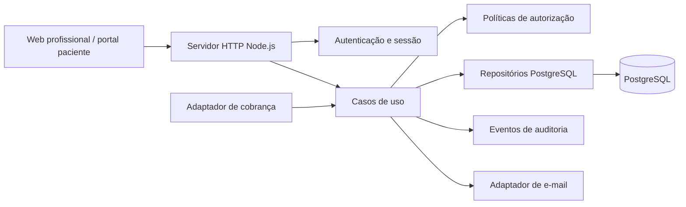

# Arquitetura SaaS proposta — NutriTrack

**Status:** proposta técnica; decisões de produto e operação ainda não aprovadas.  
**Base:** `docs/SAAS_READINESS_AUDIT.md` (2026-10-29), código em `apps/api/src/server.js` e documentação de arquitetura existente.  
**Escopo:** arquitetura-alvo e fronteiras; não implementa código nem schema.

## 1. Direção recomendada

Evoluir o monólito atual em passos verificáveis. Manter Node.js nativo, CommonJS, pnpm, servidor HTTP próprio e frontend estático enquanto esses componentes suportarem os fluxos do produto. Substituir o store JSON por PostgreSQL antes de qualquer piloto com dados reais, após decidir tenant e relações. Extrair do servidor as responsabilidades que já têm regras próprias, sem introduzir camadas vazias ou reescrever a interface sem necessidade demonstrada.

O desenho é lógico, não exige que cada caixa seja serviço ou processo independente. Inicialmente, API, web e adaptadores podem continuar no mesmo processo. Separar deploys só quando houver benefício operacional ou de escala mensurável.

## 2. Estado observado e limites

O `server.js` concentra inicialização, leitura/escrita do JSON, cookies, sessões profissionais e de pacientes em `Map`, autenticação, convite/reset, verificação de propriedade, validação, cálculos, auditoria, rotas e arquivos estáticos. As rotas usam `userId` e `owned()` para filtrar recursos profissionais; criação de avaliação, consulta, meta e plano verifica que o paciente pertence ao profissional. O portal tem cookie separado e DTO allowlist com a versão publicada do plano. Essas são proteções úteis no MVP, mas ainda não modelam organização/equipe e não são uma fronteira de banco.

O store tem coleções `users`, `patients`, `assessments`, `appointments`, `goals`, `mealPlans`, `patientInvitations`, `patientPasswordResets`, `patientAccounts` e `audit`. IDs são UUIDs e relações são referências sem foreign keys. Versões de plano e suas refeições/itens estão embutidas no agregado. As escritas serializam o objeto inteiro no processo; não há transações, coordenação interprocesso ou backup/restore demonstrado. O único teste de integração verifica cadastro, avaliação, publicação/versionamento, acesso cruzado a paciente/plano e conflito de agenda.

Riscos P0 da auditoria: store local para dados clínicos/credenciais; validade de sessão não imposta no servidor; ausência de rate limit; operação de produção sem evidência versionada. P1: tenant por convenção, cobertura negativa insuficiente, corridas check-then-act e modelo de clínica/paciente ainda não decidido. A auditoria não é pentest, revisão de infraestrutura ou avaliação legal.

## 3. Componentes e dependências propostos

| Componente | Responsabilidade | Dependências permitidas |
| --- | --- | --- |
| HTTP/bootstrap | Criar servidor, carregar configuração, encaminhar rota, serializar resposta, servir assets e tratar erro | módulos de rota, configuração e observabilidade |
| Rotas/handlers | Converter HTTP em comandos/consultas, autenticação requerida, DTO e códigos HTTP | casos de uso; não acessar SQL/store diretamente |
| Autenticação | Hash/verificação de credenciais, login, logout, recuperação, convite, sessão e cookies | repositórios de identidade/sessão, rate limiter, e-mail |
| Autorização | Resolver principal, membership ativa, permissões e escopo do recurso | membership/repositórios; nunca confiar em tenant do payload |
| Casos de uso | Fluxos transacionais: criar avaliação, agendar, publicar plano, consumir convite etc. | domínio, policies, repositórios, auditoria |
| Domínio | Regras puras para avaliação, agenda, metas, publicação e versionamento | nenhuma infraestrutura |
| Repositórios | Consultas e persistência com filtros tenant-aware, transações e mapeamento | driver/adaptador PostgreSQL |
| Auditoria | Registrar eventos relevantes com ator, tenant, alvo e horário, sem segredo/clínica em excesso | repositório de auditoria e contexto autenticado |
| Adaptadores externos | Entrega de e-mail, cobrança/webhooks, observabilidade | interfaces pequenas definidas pelos casos de uso |

Ordem razoável de extração: helpers puros e validação; policies/autorizações; casos de uso; repositório; então banco. Um módulo pode começar como arquivo/função no mesmo workspace. Não criar `packages/` compartilhados até haver mais de um consumidor real.

## 4. Identidade, tenant e autorização

### Conceitos

- **User:** identidade de login de uma profissional, paciente ou pessoa de equipe.
- **Professional profile:** dados profissionais; pode corresponder ao `users` atual, mas deve separar credencial de perfil.
- **Organization/clinic:** tenant comercial e fronteira de faturamento/dados, caso esse seja o modelo aprovado.
- **Membership:** associação de usuário a tenant, estado e papel. Pode haver múltiplas memberships; autorização avalia papel e vínculo.
- **Patient relationship:** vínculo explícito do paciente com organização/profissional, estado e período de validade. Transferir ou encerrar vínculo é operação auditada.

**Opção técnica recomendada para preparar crescimento:** organização como tenant, membership de profissional e relação de paciente com tenant; permitir tenant de uma pessoa só. A recomendação não decide se haverá equipe nem autoriza acesso compartilhado. Se o produto for exclusivamente individual, pode-se simplificar o provisionamento para uma organização individual sem abandonar as chaves tenant-aware. A proprietária deve aprovar a semântica antes de schema/migração.

### Regra de autorização por requisição

1. Validar sessão opaca no servidor e resolver `userId`; sessões profissional e paciente continuam como públicos distintos.
2. Resolver membership ativa e tenant permitido da sessão/rota; ignorar ou rejeitar `tenantId` vindo de body/query.
3. Verificar permissão para ação e papel (ex.: `patient.read`, `plan.publish`, `member.manage`).
4. Buscar/reter o recurso com `tenant_id` e, quando necessário, vínculo de paciente no próprio predicado SQL; UUID é localizador, não autorização.
5. Para paciente, resolver a conta e o vínculo ativo no servidor; expor somente DTO allowlist com versões publicadas e explicitamente autorizadas.
6. Executar mutações e evento de auditoria na mesma transação quando precisarem representar uma única ação.

Não usar somente `SELECT id = ?` seguido de checagem tardia se uma consulta tenant-scoped pode fazer ambas as verificações. Identificadores incompatíveis devem retornar resposta que não revele existência; a convenção atual de 404 pode ser mantida.

### Integridade e Row-Level Security

Garantia primária da aplicação: autenticação, membership e autorização no caso de uso; repositórios exigem contexto tenant e usam consultas com tenant; DTOs impedem campos internos no portal. Garantia do banco: foreign keys compostas, `NOT NULL`, `UNIQUE`, checks e políticas RLS podem impedir relações cruzadas ou consultas sem contexto.

RLS é defesa adicional, não substituto da autorização. Se adotada, cada transação define `app.tenant_id` a partir do contexto autenticado; conexão pooled deve limpar/resetar contexto sempre e jamais permitir que usuário SQL arbitrário defina tenant fora da API. Usar papel de aplicação sem `BYPASSRLS`; testar comportamento do owner, migrations e conexões reutilizadas. Tabelas globais de identidade, catálogo de planos de cobrança e webhooks podem exigir políticas diferentes e devem ser tratadas explicitamente.

## 5. Segurança e dados

Prioridade antes de dados reais: sessão compartilhada/persistente com expiração absoluta e ociosa validadas no servidor, revogação individual/global, rotação de token e política após redefinição de senha; limites por conta/IP/operação para login, cadastro, convite e reset; respostas uniformes; comparação de hash segura e limite de entrada de senha; e-mail transacional com links de uso único; CSRF/Origin conforme domínio e fluxo; validação de entrada consistente; logs estruturados sem URL completa, tokens, cookies, senhas, corpo ou conteúdo clínico.

Configuração fail-fast e segredos fora do repositório; HTTPS e cookie `Secure` no ambiente real; TLS para banco; permissões mínimas; dependências/runtime revisados; backups criptografados e recuperação ensaiada. Definir retenção e controle de acesso a auditoria/logs. Avaliar MFA para profissionais e contas privilegiadas. Nenhuma decisão aqui declara conformidade com LGPD.

### Auditoria de produto

Substituir a lista operacional limitada de 500 entradas por eventos duráveis e selecionados: login/logout e revogação; criação/alteração/encerramento de vínculos; convite/reset consumido ou revogado; publicação/revogação de plano; operações privilegiadas e alterações de assinatura. Registrar ator, tenant, ação, tipo/ID de alvo, horário e metadados estritamente necessários. Nunca guardar token, senha, notas clínicas ou payload integral. Definir retenção e acesso humano; não chamar o log de imutável sem controles que comprovem isso.

## 6. Persistência, API e assinaturas

PostgreSQL é a escolha recomendada por constraints, transações, índices e suporte a consultas tenant-aware. Começar com driver de PostgreSQL ou selecionar ORM após um ADR que avalie CommonJS/Node suportado, migrações revisáveis, transações, controle de SQL, pooling, backup e familiaridade da equipe. A auditoria cita Prisma como alternativa, não como decisão; não introduzir ORM, framework HTTP ou runtime ao mesmo tempo sem razão concreta.

Repositórios devem expor operações de domínio, não vazar conexões SQL às rotas. Casos com invariantes precisam de transação: ativação de convite + conta + consumo; reset + troca de senha + revogação de sessão; publicar versão + ponteiro publicado + auditoria; reservar horário; impor unicidade normalizada de e-mail. Agenda concorrente pode exigir exclusion constraint por profissional/tenant ou lock/serialização, validado no PostgreSQL.

Assinatura é domínio comercial separado dos registros clínicos. Um adaptador de pagamento mantém referência externa, plano comercial, estado local, período e estado de cancelamento; cartão fica com checkout/tokenização do provedor. Webhooks são autenticados, idempotentes e armazenados com chave de evento. Política para inadimplência, período de tolerância, cancelamento e exportação é decisão da proprietária. Atraso de pagamento não deve apagar nem alterar dados clínicos automaticamente; definir leitura/exportação e retenção.

## 7. Ambientes e infraestrutura

| Ambiente | Dados e finalidade | Controles mínimos |
| --- | --- | --- |
| Desenvolvimento | Dados sintéticos e credenciais locais | `.env` local fora do Git, banco descartável, nenhuma cópia de store real |
| Homologação | Fixture sintética representativa e validação de migração/deploy | contas/segredos próprios, acesso restrito, isolamento de produção, restore ensaiado |
| Produção | Dados autorizados do serviço | PostgreSQL gerenciado em região aprovada, TLS, rede/credenciais mínimas, segredos geridos, backup, alertas, acesso nominal |

Critérios de escolha (sem fornecedor pré-selecionado): localização/residência de dados e contratos; recuperação point-in-time e teste de restore; TLS, controle de rede e papéis; pooling e limites de conexão; disponibilidade e suporte; portabilidade/exportação; custo previsível; integração com deploy, secrets e e-mail; evidência de incidentes e controles. Aplicação pode permanecer em hospedagem Node gerenciada ou VM/container; decisão depende de operação e orçamento, não de preferência de framework.

Definir CI para instalar de forma reproduzível, formatar/verificar, executar testes e migrações em banco efêmero; deploy de homologação e promoção aprovada; migrações compatíveis com versão anterior durante rollout. Monitorar disponibilidade, erros, latência, conexões DB, fila de e-mail, abuso de autenticação e sucesso de backup sem payload clínico. Runbooks devem cobrir indisponibilidade DB/e-mail, exposição de credencial, acesso indevido, restauração e rollback de release.

## 8. Decisões abertas

| Decisão da proprietária/equipe competente | Por que bloqueia definição final |
| --- | --- |
| Tenant: profissional individual, consultório, ambos; papéis de equipe | Determina ownership, memberships, faturamento e policies |
| Paciente compartilhado, transferido ou duplicado; identidade/portal | Determina chaves, convite, leitura histórica e encerramento |
| Dados visíveis no portal, revogação e duração | Define DTO, retenção e escopo de consentimento/experiência |
| País/região, provedor, residência e nível de serviço | Determina infraestrutura, contratos, RPO/RTO e custo |
| Retenção, exportação, correção, exclusão e auditoria | Afeta soft delete, retenção de versões e obrigações do produto |
| MFA/recuperação de profissionais e suporte privilegiado | Afeta autenticação e processo de recuperação |
| E-mail, pagamentos, cobrança individual ou por clínica | Define integração, estados e fluxo de assinatura |
| Responsáveis por operação, incidente e backup | Necessários para serviço contínuo e resposta efetiva |
| Origem e legitimidade dos dados locais em `data/store.json` | Pessoa autorizada deve confirmar antes de qualquer importação |

## 9. Critérios de prontidão arquitetural

Antes do piloto: matriz de rotas/papéis e testes negativos completa; persistência transacional com constraints tenant-aware; sessão e limite de abuso operacionais; restauração de backup medida contra RPO/RTO aprovados; migração conciliada, repetível e rollback ensaiado; logs minimizados; operação e suporte atribuídos; acesso do portal explicitamente aprovado; revisão de segurança e privacidade por responsáveis competentes. O plano não certifica prontidão nem conformidade.

## Referências internas

- `docs/SAAS_READINESS_AUDIT.md`
- `docs/architecture/current-state.md`
- `docs/architecture/target.md` (proposta anterior, não aprovada)
- `docs/development/migration-plan.md`
- `docs/development/meal-plans.md`
- `docs/development/patient-portal.md`
