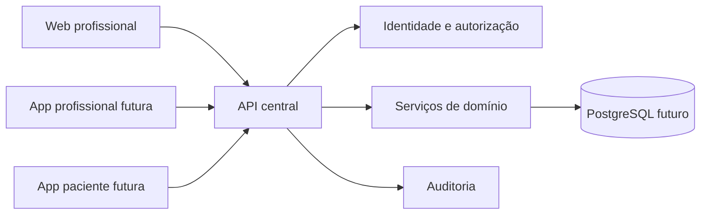

# Arquitetura alvo — proposta incremental

## Direção

Monorepositório pnpm com uma API como autoridade de validação, autorização e persistência. A web e futuras apps móveis consomem a mesma API. Introduzir frameworks apenas quando houver benefício de manutenção claro.



## Estrutura alvo por fases

```text
apps/web/                         Next.js após migração verificável
apps/api/                         API modular (NestJS ou alternativa validada)
apps/mobile-professional/         Expo após contrato API estabilizar
apps/mobile-patient/              Expo após vínculo seguro de paciente
packages/shared-types/            somente contratos realmente partilhados
packages/validation/              schemas compartilhados quando apropriado
packages/api-client/              cliente tipado após OpenAPI
packages/domain/                  regras puras compartilhadas quando útil
prisma/                           schema e migrações após validação do domínio
docs/                              ADRs, domínio, operação e arquitetura
```

Não criar apps/pacotes vazios antes de haver consumidor. Neste marco existem apenas API e web; a API ainda serve a interface, portanto os deploys não são independentes.

## Camadas propostas

1. **HTTP:** rotas/controllers e DTOs; converter requisições e padronizar erros.
2. **Application:** casos de uso, transações e autorização contextual.
3. **Domain:** regras puras de avaliações, agenda, metas e versão de plano.
4. **Infrastructure:** repositórios, sessões, armazenamento e auditoria.
5. **Contracts:** OpenAPI e tipos/clientes gerados quando aplicável.

Evitar camadas vazias. Primeiro extrair funções puras e casos de uso testáveis; substituir persistência atrás de interfaces ao migrar para banco.

## Domínio multi-tenant provisório

Modelo a validar: `User` (identidade), `ProfessionalProfile`, `Patient`, `ProfessionalPatient` (vínculo/estado/datas), `Assessment`, `Appointment`, `Consultation`, `PatientGoal`, `MealPlan`, `MealPlanVersion`, `AuditEvent`. Todo registro profissional deve carregar `professionalId` ou ter vínculo verificável pelo servidor. O paciente deve ser vinculado por convite de uso único, com expiração e verificação; ID não é autorização. Profissional publica uma versão específica e escolhe explicitamente quais dados aparecem no portal. Notas clínicas internas ficam fora do DTO do paciente.

É proposta, não schema aprovado. Relações com clínicas/equipes, retenção e exclusão precisam de decisão do domínio e revisão apropriada. PostgreSQL poderá reforçar isolamento com row-level security, sem substituir autorização na aplicação.

## Migração de tecnologia

- **Agora:** workspaces sem dependências; API e web atuais continuam operacionais.
- **Depois:** testes unitários de domínio e separação gradual do monólito.
- **Persistência:** schema validado; importador JSON idempotente; contagens conciliadas; backup preservado até decisão de retirada.
- **Framework:** comparar NestJS/Next.js/Expo em entregas separadas e preservar testes de comportamento.
- **Paciente:** implementar cliente somente após convite, autorização e contrato publicado testados no servidor.

## Segurança e operação pendentes

Store JSON, sessões em memória, falta de rate limiting/recuperação, segredos, backups e pipeline tornam o app somente de desenvolvimento. Operação real exige threat model, papéis e bases legais revisados, controles de sessão, HTTPS, backups restauráveis, logs sem dados clínicos e revisão independente de segurança/privacidade.
